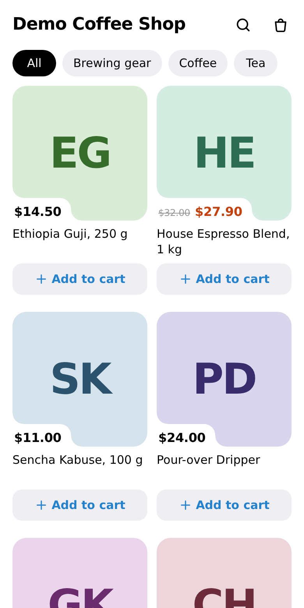
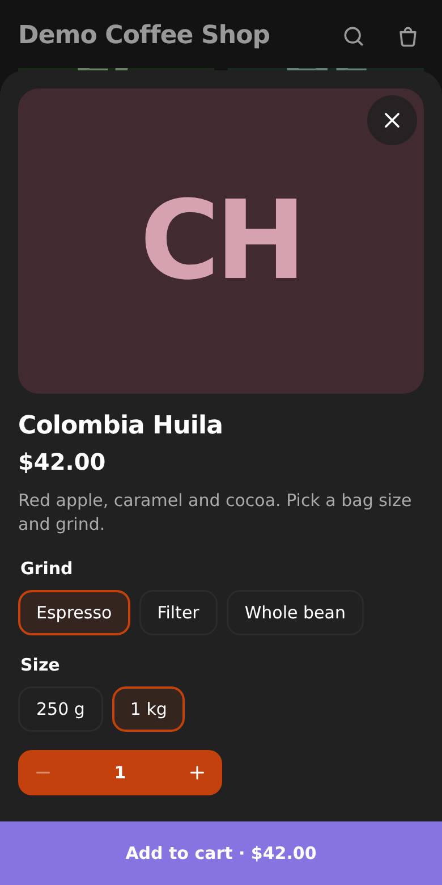
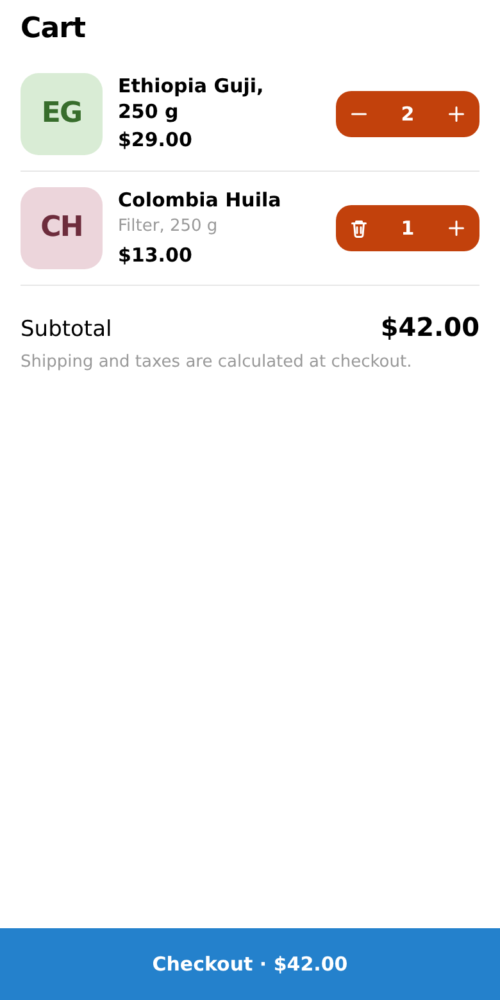

# Mini Shop for Telegram

A free, self-hosted WordPress plugin for WooCommerce stores. It turns the store into a Telegram Mini App on the
merchant's own bot: buyers browse the catalog, pick variations and fill a cart inside Telegram, pay on the
normal WooCommerce checkout, and get order status updates from the bot. No SaaS, no third-party server. The
plugin only talks to Telegram.

This is a personal project by Sunnatulla E. The products in the screenshots are sample data created by
`dev/seed.php`.

| Catalog (light) | Product sheet (dark) | Cart (light) |
| --- | --- | --- |
|  |  |  |

## Features

- **Mini App storefront** (`/?mstg_app=1`): category chips, search, product grid, product sheet with variation
  options, quantity steppers, cart kept in `localStorage`. It follows the buyer's Telegram light or dark theme
  and uses Telegram's MainButton, BackButton and haptics. Loading, empty and error states, RTL-safe CSS.
- **Simple and variable products**, including "any" attributes. Price, stock and quantity limits come from WooCommerce.
- **Signed checkout handoff.** The Mini App posts the cart together with Telegram `initData`. The server checks
  the signature (HMAC-SHA256 with key `HMAC("WebAppData", bot_token)`, `hash_equals`, `auth_date` at most 24 h
  old), rejects duplicate fields, re-validates every line against live product data and returns a one-time
  checkout link that expires after 15 minutes. The link fills the WooCommerce cart and opens the regular
  checkout, so gateways, shipping, taxes and coupons keep working. Classic and block checkout both work.
- **Orders remember the Telegram buyer** (order meta, shown on the order screen; HPOS compatible).
- **Status messages:** when an order moves to a status the merchant ticked, the bot sends the buyer a message.
  The send runs in the background through Action Scheduler, and failures are written to the order notes.
- **One-step bot setup:** saving the token calls `getMe`, `setWebhook` (with a random `secret_token`) and
  `setChatMenuButton` (web_app). The webhook answers `/start` with a button that opens the shop.
- **Token handling:** stored in a non-autoloaded option and never printed back. Errors returned by the
  transport are scrubbed of it.
- Translation ready (`.pot`), with Russian and Uzbek translations. `uninstall.php` removes the options and the webhook.

## Stack

PHP 8.1+, WordPress 6.6+, WooCommerce 9+ (HPOS and cart/checkout blocks declared compatible), WordPress REST
API (`mstg/v1/catalog`, `/checkout`, `/webhook`), Telegram Bot API and Mini Apps (`telegram-web-app.js`).
The front end is vanilla JavaScript ES modules bundled with esbuild. Tests: PHPUnit, Vitest, and an end-to-end
run with Playwright against WordPress Playground.

## Layout

```
mini-shop-for-telegram.php   plugin header, constants, compat declarations
includes/                    one class per concern: Init_Data, Bot_Api, Bot_Setup, Webhook, Catalog,
                             Checkout, Handoff, Orders, Notifications, Settings_Page, Storefront, I18n
templates/                   settings screen and the Mini App shell
src/                         Mini App source (api, cart, variations, telegram, dom, format)
assets/                      built bundle + CSS
languages/                   .pot, ru_RU, uz_UZ
dev/                         Playground blueprints, seed data, fake Bot API, build, Plugin Check runner
tests/                       php (PHPUnit), js (Vitest), e2e (Playwright)
```

## Run it locally

You need Node 20+ and Google Chrome (or set `CHROME_PATH`). PHP is not needed: WordPress runs in
[WordPress Playground](https://wordpress.github.io/wordpress-playground/).

```bash
npm ci
npm run build        # bundles src/ into assets/app.js
npm start            # WordPress + WooCommerce on http://127.0.0.1:9400, 6 sample products, fake Bot API on :8081
```

Open `http://127.0.0.1:9400/wp-admin/admin.php?page=mini-shop-for-telegram`, paste any token-shaped string
(for example `4242:local-test`) and save. In development, `dev/mu-plugins/mstg-dev.php` points Bot API calls at
the fake server through the `mstg_bot_api_base` filter, so nothing reaches Telegram. The Mini App is at
`http://127.0.0.1:9400/?mstg_app=1`.

On a real site: create a bot with @BotFather, paste its token on the settings page (the site must be on HTTPS),
then send `/start` to the bot.

## Tests

```bash
npm test             # Vitest: cart, variations, API client, price format, initData signing
npm run test:php     # PHPUnit for the initData validator (runs PHP in Playground's WebAssembly runtime)
npm run lint         # ESLint
npm start & npm run e2e   # Playwright E2E, see below
bash dev/dist.sh && node dev/plugin-check.mjs   # build the release zip and run the official Plugin Check on it
```

The E2E run signs real `initData` with a test token and injects a Telegram WebApp stub. It covers:

1. saving the token connects the bot and the token is never printed back;
2. the webhook rejects a wrong secret and answers `/start` with a web_app button;
3. the dark theme renders the catalog, product sheet and cart;
4. tampered `initData` gets 401 and the buyer is told why;
5. catalog → variable product → cart → MainButton → block checkout → order;
6. the order holds the Telegram user id and the chosen variation;
7. setting the order to "completed" sends the buyer a message (checked on the fake Bot API);
8. a checkout link works only once.

It also writes the screenshots in `docs/screenshots/`.

## Hooks

| Filter | Default | Use |
| --- | --- | --- |
| `mstg_init_data_max_age` | `86400` | Max age of Telegram `initData` in seconds (0 turns the check off). |
| `mstg_status_message` | built-in text | Change the status message (Telegram HTML; escape what you add). |
| `mstg_bot_api_base` | `https://api.telegram.org` | Bot API base URL (used for the local fake). |

## Licence

GPL-2.0-or-later, the licence WordPress plugins use. See `LICENSE`.
